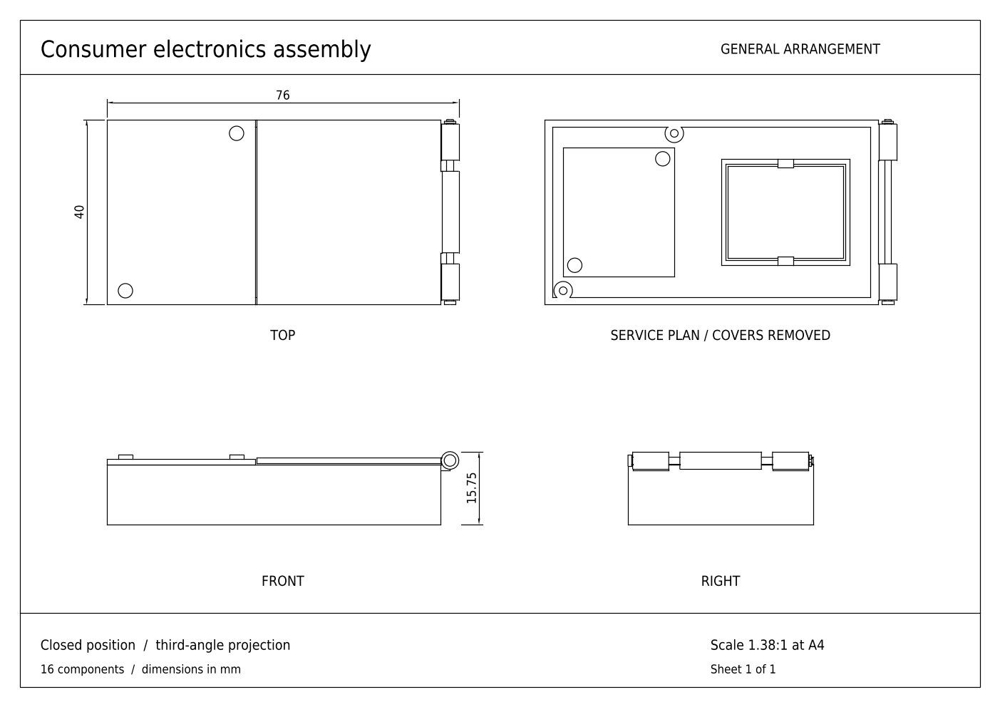

# Consumer CAD AI

用中文描述结构需求，让 Codex 生成消费电子零件和装配，检查干涉与翻盖运动，再导出 FreeCAD 工程、STEP 和工程图。

**[下载 Windows x64 免安装版](https://github.com/phyartego/CAD_designer/releases/download/v0.1.0/Consumer-CAD-AI-v0.1.0-Windows-x64-Portable.zip)** · [所有发布版本](https://github.com/phyartego/CAD_designer/releases) · [查看电池仓成品](examples/output/hinged-enclosure.zip)

## Windows 10 / 11 快速开始

1. 下载 `Windows-x64-Portable.zip`，右键选择 **全部解压缩**，放到一个可写的目录。
2. 双击 **`Run-Demo.cmd`**。程序会生成翻盖电池仓并打开结果目录 `outputs/`。双击 **`Open-FreeCAD.cmd`**，在 FreeCAD 里打开生成的 `assembly.FCStd`。
3. 要用自然语言设计，双击 **`Start-Codex.cmd`**，按提示登录并信任解压目录。使用 `/mcp` 可查看 `consumer-cad` 工具。Codex 的建模结果保存在 `workspace/`。

ZIP 自带 Python、CAD 依赖、FreeCAD（含图形界面）和 Codex CLI。运行样例和查看工程可以离线完成，使用 Codex 对话需要联网和可用账号。

> 帮我设计一个金属翻盖电池仓，给 25 × 20 × 12 mm 电池和 PCB 留出安装空间。先检查 13 mm 高的机身，再找出通过 0–110° 开合检查的最小机身高度，最后导出 FCStd、STEP、PDF 和 BOM。

## 示例与输出

示例装配包含 16 个零件，按指定角度检查闭合和开盖干涉。打开 FCStd 后，可用 `HingedParts.OpeningAngle` 调整开盖角度。每次构建保存设计输入和验证报告，通过校验后生成装配及单件 STEP、FCStd、DXF、PDF、BOM 和 PNG 预览。

| 我想做什么 | 从哪里开始 |
| --- | --- |
| 调整电池仓尺寸、PCB 与转轴位置 | [参数化电池仓 JSON](examples/hinged-enclosure.json) |
| 用盒体、圆柱和布尔运算设计新装配 | [传感器卡座 JSON](examples/sensor-clip.json) |
| 用草图、扫掠或放样创建自定义结构 | [build123d 桌面支架配方](examples/desktop_stand.py) |

## 源码与其他部署方式

- [Windows 源码安装、Ubuntu Server、CLI 与本地 MCP](docs/deployment.md)
- [建模接口、几何验证与出图规则](docs/architecture.md)
- [通过远程 MCP 接入 ChatGPT 网页](docs/remote.md)
- [从源码构建 Windows 便携包](docs/portable.md) · [MIT 许可证](LICENSE)
