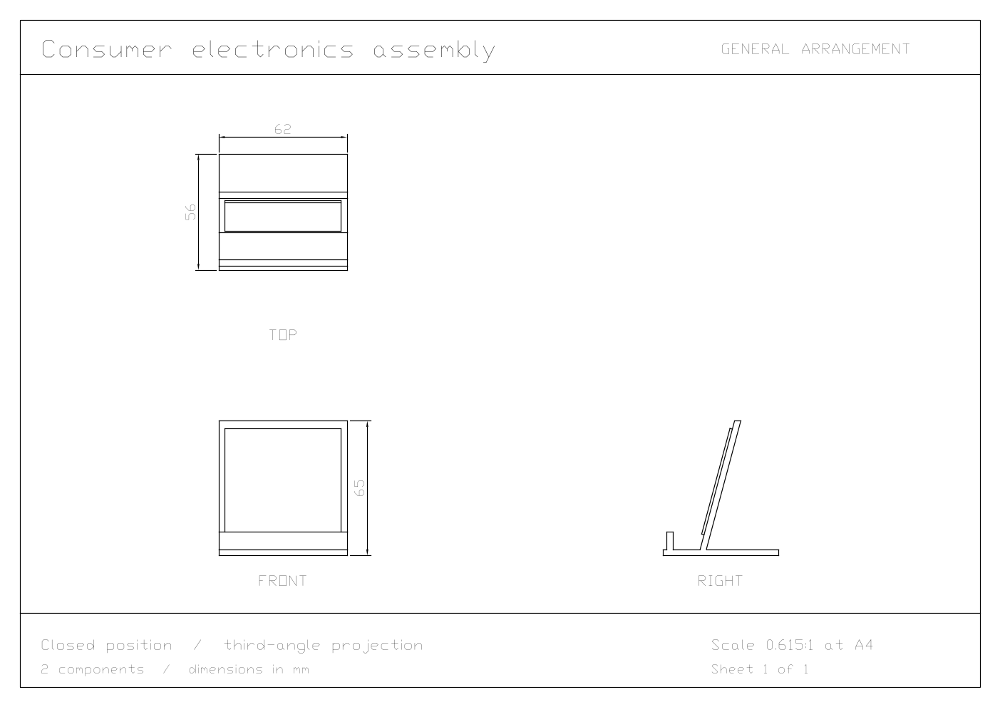

# Consumer CAD AI

**Verified 3D Consumer-Electronics CAD Modelling, Interference Checking, and Engineering Drawings for Any AI Agent**

[简体中文](README.md) | **English**

**[Download Windows x64 Portable ZIP (v0.1.0)](https://github.com/phyartego/CAD_designer/releases/download/v0.1.0/Consumer-CAD-AI-v0.1.0-Windows-x64-Portable.zip)** · [All Releases](https://github.com/phyartego/CAD_designer/releases) · [Download Stand Deliverables](examples/output/desktop-stand.zip)

---

## Overview

**Consumer CAD AI** gives any AI coding agent or assistant a deterministic, verifiable 3D CAD toolchain powered by `build123d` (Open CASCADE) and FreeCAD:

- **Zero-install portable bundle**: The Windows x64 release ZIP bundles **Python 3.12 + all CAD/MCP dependencies + FreeCAD 1.1.2 (GUI & CLI)**. No pre-installed Python or FreeCAD required.
- **Completely agent-agnostic**: Exposes standard **MCP (`stdio`)**, **`SKILL.md`**, and a **local CLI (`cad.cmd`)** with zero vendor lock-in — works out of the box with **WorkBuddy**, Cursor, Claude Desktop / Code, Windsurf, Cline, Antigravity, and any MCP or terminal agent.
- **Verify before exporting**: Measures bounding boxes, mounting clearances, pairwise solid overlap (`1e-5 mm³` tolerance), and sampled hinge motion before producing engineering deliverables.

---

## Showcase: Aluminum Desktop Phone Stand

Generated from [examples/desktop_stand.py](examples/desktop_stand.py): a two-part assembly (**Aluminium stand + Polymer anti-slip pad**, `62 × 56 × 65 mm`, `15°` tilt with raised front stop). This is also the default offline demo in `Run-Demo.cmd`. Click the drawing above to download [desktop-stand.zip](examples/output/desktop-stand.zip).

7 deliverables produced on every verified build

| Artifact | Purpose |
| --- | --- |
| `assembly.FCStd` | Native FreeCAD assembly document with groups, materials, and read-only design JSON (open with `Open-FreeCAD.cmd`) |
| `assembly.step` & `parts/*.step` | Full assembly and per-part STEP files sharing the same assembly datum |
| `assembly.dxf` | Third-angle orthographic views (TOP / FRONT / RIGHT) with overall dimensions in mm |
| `assembly.pdf` | A4 landscape general-arrangement drawing |
| `preview.png` | Rasterized drawing preview returned directly to agents via `preview_run` |
| `bom.csv` | Bill of materials with part name, material, quantity, solid volume (`mm³`), and STEP path |
| `verification.json` & `design.json` | Full geometric measurements, overlap checks, and input snapshot |

---

## Windows 10 / 11 Portable Quick Start (3 Steps)

1. **Download & Extract**: Download **[Consumer-CAD-AI-v0.1.0-Windows-x64-Portable.zip](https://github.com/phyartego/CAD_designer/releases/download/v0.1.0/Consumer-CAD-AI-v0.1.0-Windows-x64-Portable.zip)**, right-click → **Extract All...** into a short writable path (e.g. `C:\CAD`).
2. **Try Offline Demo & 3D Viewer**:
   - Double-click **`Run-Demo.cmd`** to build the Aluminum Desktop Phone Stand offline and open `outputs\desktop-stand-*`.
   - Double-click **`Open-FreeCAD.cmd`** and open `assembly.FCStd` to inspect the 3D assembly.
3. **Generate Universal Agent Config**:
   - Double-click **`Setup-Agent.cmd`** to generate `mcp.json` and `.mcp.json` with your exact extraction path and copy the standard MCP JSON to your clipboard.

---

## Connect Any AI Agent

### WorkBuddy (2 Steps)
1. Open **WorkBuddy** → **Connectors** → **Custom Connector** → choose **`stdio`** transport → paste the JSON copied by `Setup-Agent.cmd` (or fill in the printed `Command`, `Args`, and `Env` fields), then save and approve.
2. *(Recommended)* Import [`skills/consumer-cad/SKILL.md`](skills/consumer-cad/SKILL.md) as a custom Skill so WorkBuddy follows unit checks, clearance verification, and drawing review rules.

### Any Other MCP or Workspace Agent

| Client | How to Connect |
| --- | --- |
| **Cursor / Claude Desktop / Windsurf / Cline / Cherry Studio** | Paste the `mcp.json` generated by `Setup-Agent.cmd` into your client's MCP configuration. |
| **Claude Code / Antigravity / Workspace Agents** | Open the extracted folder directly — `.mcp.json`, [`AGENTS.md`](AGENTS.md), [`CLAUDE.md`](CLAUDE.md), and [`.agents/skills/consumer-cad/SKILL.md`](skills/consumer-cad/SKILL.md) are pre-configured. |
| **Terminal Coding Agents** | Run `.\cad.cmd` directly (e.g., `.\cad.cmd recipe examples\desktop_stand.py --out outputs\stand-01 --freecad`). |

---

## Modeling Modes

| Goal | Entry Point & Example |
| --- | --- |
| **Custom freeform brackets, sweeps, lofts** | Python `build(parameters)` recipe → [examples/desktop_stand.py](examples/desktop_stand.py) |
| **Declarative multi-part box/cylinder assemblies** | MCP `solid_schema` / `check_custom` / `build_custom` → [examples/sensor-clip.json](examples/sensor-clip.json) |
| **Parametric hinged metal battery enclosure** | MCP `enclosure_defaults` / `optimize_enclosure_height` → [examples/hinged-enclosure.json](examples/hinged-enclosure.json) ([deliverables](examples/output/hinged-enclosure.zip)) |

---

## Documentation (Chinese)

- [Source Deployment & Agent Setup (Windows / Ubuntu Server)](docs/deployment.md)
- [Architecture, Geometry Verification & Drawing Rules](docs/architecture.md)
- [Remote Streamable HTTP MCP with OAuth](docs/remote.md)
- [Building the Windows Portable Bundle](docs/portable.md) · [MIT License](LICENSE)
